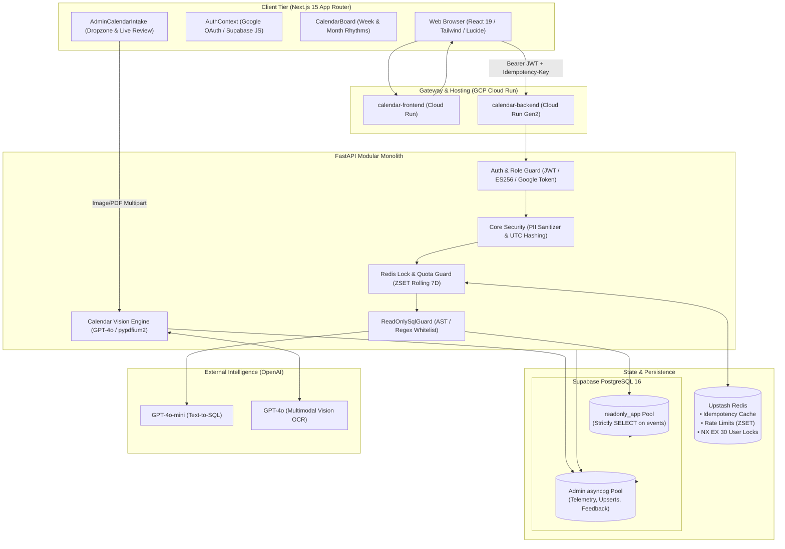
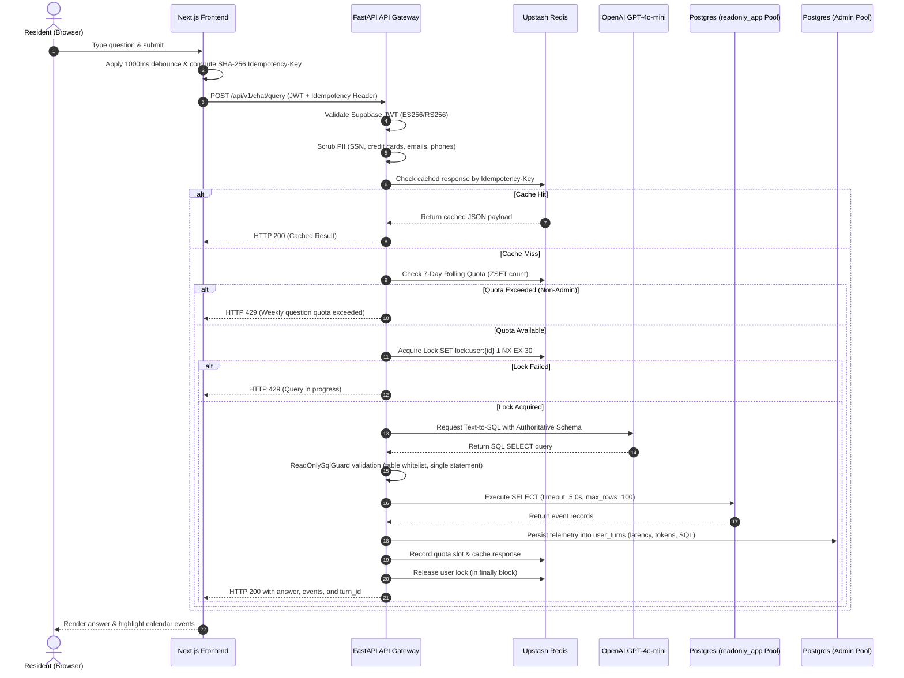
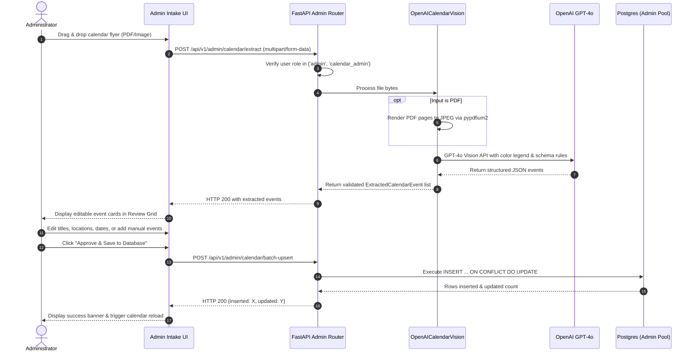
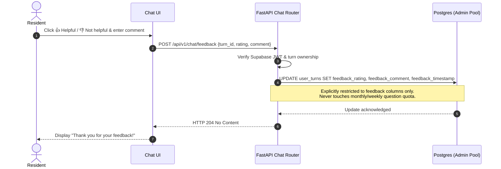
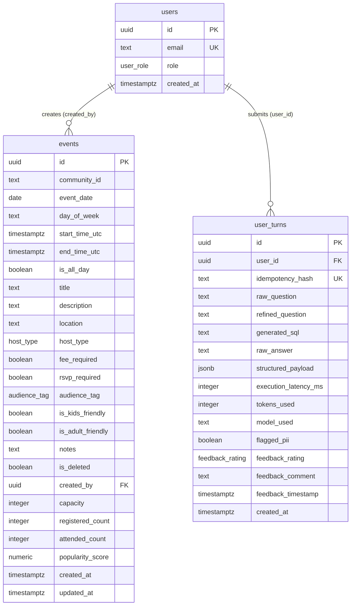
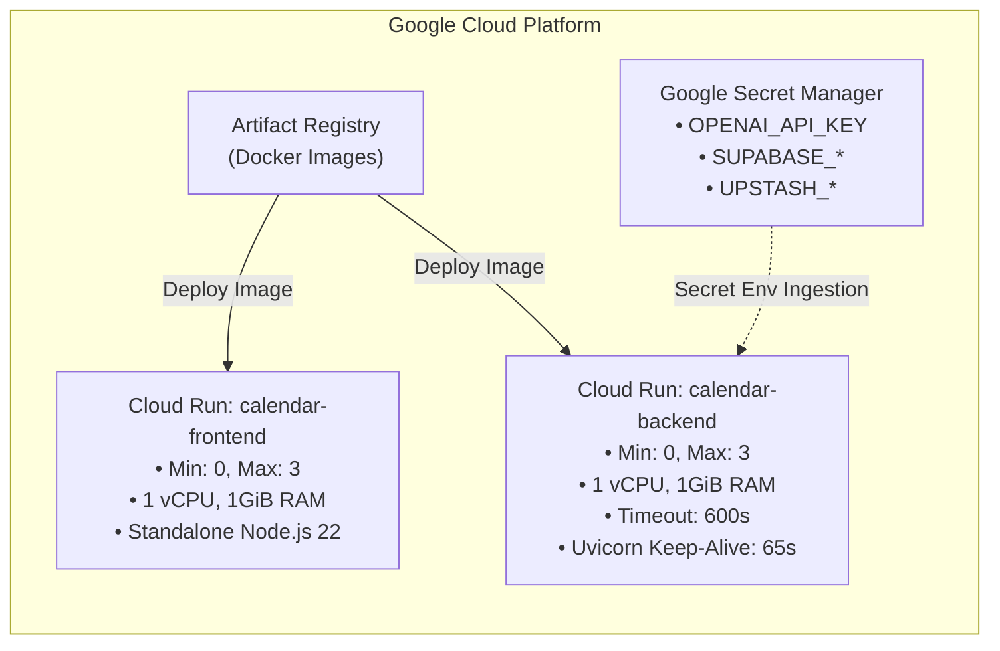

# 🐺 Wolf Ranch Community Calendar (`project_WR`)

[](https://fastapi.tiangolo.com)
[](https://nextjs.org)
[](https://react.dev)
[](https://www.python.org/)
[-4169E1?style=flat&logo=postgresql&logoColor=white)](https://supabase.com)
[](https://upstash.com)
[](https://openai.com)
[](https://cloud.google.com/run)

A cloud-native, AI-augmented community intelligence platform and resident portal designed for the **Wolf Ranch** master-planned community in **Georgetown, TX**.

Wolf Ranch Community Calendar unites natural language calendar search, interactive weekly and monthly rhythm boards, RFC 5545 `.ics` and Google Calendar exports, and an automated administrator ingestion engine powered by **OpenAI GPT-4o Vision** and **pypdfium2** document parsing.

---

## 📑 Table of Contents

- [Overview & Value Proposition](#-overview--value-proposition)
- [System Architecture](#-system-architecture)
- [Technical Specifications & Architecture Principles](#-technical-specifications--architecture-principles)
- [Feature Highlights](#-feature-highlights)
  - [Resident Experience](#1-resident-experience)
  - [Administrator Experience](#2-administrator-experience)
- [Userflows](#-userflows)
- [System Workflows & Data Pipelines](#-system-workflows--data-pipelines)
  - [1. Natural Language Query & Sandboxed Text-to-SQL](#1-natural-language-query--sandboxed-text-to-sql-pipeline)
  - [2. Multi-Stage Calendar Flyer Intake & OCR](#2-multi-stage-calendar-flyer-intake--ocr-pipeline)
  - [3. Isolated Resident Feedback Loop](#3-isolated-resident-feedback-pipeline)
- [Database Schema & Security Sandboxing](#-database-schema--security-sandboxing)
- [Cloud Infrastructure & Deployment](#-cloud-infrastructure--deployment)
- [Environment Configuration](#-environment-configuration)
- [Local Development Guide](#-local-development-guide)
- [Repository Structure](#-repository-structure)
- [Roadmap & Verification Status](#-roadmap--verification-status)

---

## 🌟 Overview & Value Proposition

Community calendars often suffer from fragmented distribution (static PDF flyers, bulletin boards, email newsletters, and closed social media groups). Residents frequently miss events or struggle to find relevant activities for their families.

**Wolf Ranch Community Calendar** solves this through an end-to-end automated architecture:
1. **Intelligent Ingestion:** Admins simply upload monthly graphic flyers or multi-page PDFs. GPT-4o Vision analyzes layout, color legends, event tags, locations, and times, turning unstructured documents into verified, structured database records.
2. **Interactive Rhythm Boards:** Residents browse neighborhood events through a fluid weekly board with swipe gestures or a monthly birds-eye view, with one-click synchronization to Google Calendar or Apple Calendar (`.ics`).
3. **Conversational Assistant:** Residents ask plain-English questions (*"What events are happening for kids this Saturday?"* or *"Are there any workout sessions?"*). The system uses strict text-to-SQL compilation to query PostgreSQL directly in a zero-mutation, read-only sandbox.
4. **Defensive Enterprise Architecture:** Built with double-spend lock defense, rolling 7-day quotas, deterministic SHA-256 caching, pre-LLM PII scrubbing, SSE connection keep-alives, and unprivileged database roles.

---

## 🏗 System Architecture

The solution uses a **Modular Monolith** architecture for the backend paired with a modern **Next.js 15 App Router** frontend, orchestrated on **Google Cloud Run** and backed by **Supabase (PostgreSQL 16)** and **Upstash Redis**.



### Trust Boundaries & Isolation

- **Service-Role Boundary:** Privileged service keys and database credentials exist exclusively within Cloud Run environment secrets injected from Google Secret Manager. They are never transmitted or exposed to the client bundle.
- **Database Privilege Separation:** LLM-generated SQL queries execute exclusively against the unprivileged `readonly_app` connection pool, which is restricted strictly to `SELECT` on `public.events`. All mutation operations (`INSERT`, `UPDATE`, `DELETE`, `TRUNCATE`) are revoked at the database role level.
- **Time Horizon Boundary:** All database timestamps, Redis sorted set scores, and query computations strictly adhere to UTC. Localization to Central Time (Georgetown, TX: `America/Chicago`) or browser-local time is handled purely at the presentation boundary.

---

## 🛡 Technical Specifications & Architecture Principles

The project strictly follows the quality gates established across system roles:

| Category | Specification & Gate | Implementation Detail |
| :--- | :--- | :--- |
| **Concurrency & Double-Spend** | Distributed Redis Lock | Each query acquires `lock:user:{user_id}` with `NX EX 30`. Downstream execution is wrapped in an unconditional `try...finally` block executing `redis.delete(...)` to eliminate zombie locks. |
| **Deterministic Idempotency** | Hourly Request Deduplication | Requests compute `SHA256(user_id:normalized_question:current_utc_hour)`. Cached answers are returned instantly, preventing duplicate LLM billing and execution. |
| **Quota Enforcement** | Rolling 7-Day Window | Non-admin residents are allocated **5 queries per rolling 7-day window** tracked via Redis sorted sets (`ZADD`, `ZREMRANGEBYSCORE`). Admins bypass quotas with unlimited queries. |
| **Feedback Isolation** | Strict Path & Permission Isolation | `POST /api/v1/chat/feedback` updates only `feedback_rating`, `feedback_comment`, and `feedback_timestamp` on `user_turns`. It never touches or decrements question quota. |
| **Anti-Spam UI Defense** | Synchronous In-Flight Locks | Submitting a question synchronously disables submit buttons, sets the input to read-only, displays loading indicators, and enforces a **1000ms debounce**. |
| **Connection Longevity** | Resilient Streaming & Heartbeats | Cloud Run allows 600s timeouts for long OCR operations. SSE streams emit `: ping\n\n` comments every 5 seconds to prevent intermediate proxy 504 timeouts. |
| **Data Privacy (PII)** | Pre-LLM Regex Sanitizer | Questions are scrubbed for SSNs, credit cards, emails, and phone numbers before triggering any OpenAI API request. High-risk inputs are rejected immediately. |
| **SQL Sandboxing** | Multi-Layer AST & Table Whitelist | SQL Guard permits only single `SELECT` or `WITH` queries against `public.events`. Disallows multiple statements, table mutations, DDL, and queries targeting `users` or `user_turns`. Enforces 5s timeouts and 100-row limits. |

---

## ✨ Feature Highlights

### 1. Resident Experience

- **Natural Language Calendar Queries:** Residents search for events using intuitive language (*"Are there any food trucks this Friday?"*, *"Show me kids activities next weekend"*).
- **Synchronized Calendar Result Visualizer:** Relevant events are not only answered in plain text, but also extracted as structured records and highlighted directly in the calendar board.
- **Interactive Weekly Rhythm Board:**
  - View events by day with responsive column layouts.
  - Previous / Next week navigation with "This week" reset button.
  - Mobile swipe gestures (`onTouchStart`, `onTouchMove`, `onTouchEnd`) for seamless touch navigation.
  - Quick location filter (e.g. *The Den*, *River Camp*, *Southfork Recreation Center*).
- **Monthly Grid View:** Bird's-eye view across all events in any month, complete with day-by-day badges and an active pulse indicator for "Today".
- **Modal Event Inspector:** Detailed dialog displaying event date, time, location, host type, audience tag, RSVP/fee requirements, and full descriptive notes.
- **One-Click Calendar Sync:**
  - **Google Calendar:** Auto-generates pre-filled Google Calendar web URLs with UTC start/end timestamps and normalized Georgetown, TX locations.
  - **Apple Calendar / Outlook:** Downloads an RFC 5545 compliant `.ics` calendar file with properly escaped summary, location, and description fields.
- **Resident Feedback System:** Interactive Thumbs Up / Thumbs Down buttons and an expandable comment box with Enter-to-submit ergonomics.
- **Defensive UI & Quota Visibility:** Real-time quota badges (*"7-day quota: X / 5"* or *"Admin access: Unlimited"*), disabled states during active requests, and Google Sign-in prompts when unauthenticated.

### 2. Administrator Experience

- **Role-Based Access Control (RBAC):** Verified using Supabase JWT claims and backend database roles (`admin`, `calendar_admin`). Admin accounts receive bypass privileges for chat locks and quotas.
- **GPT-4o Multimodal Vision Intake:**
  - Drag-and-drop intake supporting **JPEG, PNG, WEBP, and multi-page PDF documents** (rendered via `pypdfium2`).
  - Interprets visual color-coded flyer legends:
    - 🟣 **Purple** &rarr; HOA Event
    - 🟠 **Orange** &rarr; Food Truck
    - 🔵 **Blue** &rarr; Paid Fitness
    - 🌸 **Pink** &rarr; Homeowner Hosted
    - 🟢 **Green** &rarr; HOA Announcement
    - 🔘 **Bottom Section** &rarr; Community Gathering
  - Normalizes shorthand locations (e.g., *"RC"* &rarr; *"River Camp"*, *"Den"* &rarr; *"The Den"*).
  - Normalizes Central Time (America/Chicago) to UTC ISO-8601 timestamps.
- **Two-Stage Human-in-the-Loop Review:**
  1. **Stage 1 (Extract):** `POST /api/v1/admin/calendar/extract` parses the document and returns extracted events for administrative verification.
  2. **Stage 2 (Review & Edit):** Admin inspects the editable event cards in the frontend, adjusts titles, dates, times, tags, or adds manual events.
  3. **Stage 3 (Batch Upsert):** `POST /api/v1/admin/calendar/batch-upsert` commits all approved events into PostgreSQL.
- **Streaming Ingestion Alternative:** Real-time Server-Sent Events endpoint (`POST /api/v1/admin/calendar/ingest/stream`) broadcasting granular stage progress (`upload_received` &rarr; `vision_ocr_processing` &rarr; `parsing_and_validating` &rarr; `database_upsert` &rarr; `complete`) with 5s heartbeat pings.
- **Idempotent Database Upsert:** Backed by a composite unique PostgreSQL index to prevent accidental duplication during re-ingestion.

---

## 🔄 Userflows

```mermaid
graph TD
    subgraph ResidentFlow["Resident Userflow"]
        R1[Visit Calendar Portal] --> R2{Browse Calendar}
        R2 -->|Weekly Rhythm| R3[Inspect Day Columns & Filter Location]
        R2 -->|Monthly Grid| R4[View Month-at-a-Glance]
        R3 & R4 --> R5[Click Event: Open Modal Details]
        R5 --> R6[Export to Google Calendar or Apple .ics]
        
        R1 --> R7[Ask Natural Language Question]
        R7 --> R8{Authenticated?}
        R8 -->|No| R9[Prompt Google OAuth Modal]
        R9 --> R10[Sign In with Google]
        R10 --> R11[Submit Question]
        R8 -->|Yes| R11
        R11 --> R12[View Answer & Highlighted Results]
        R12 --> R13[Submit Thumbs Up/Down & Comment]
    end

    subgraph AdminFlow["Administrator Userflow"]
        A1[Sign in as Admin] --> A2[Access Admin Intake Portal]
        A2 --> A3[Upload Calendar Flyer Image or PDF]
        A3 --> A4[GPT-4o Vision AI Extraction]
        A4 --> A5[Review Extracted Events Form]
        A5 --> A6[Modify Fields / Add Manual Events]
        A6 --> A7[Click 'Approve & Save to Database']
        A7 --> A8[Events Idempotently Upserted to Supabase]
    end
```



---

## ⚡ System Workflows & Data Pipelines

### 1. Natural Language Query & Sandboxed Text-to-SQL Pipeline



### 2. Multi-Stage Calendar Flyer Intake & OCR Pipeline



### 3. Isolated Resident Feedback Pipeline



---

## 🗄 Database Schema & Security Sandboxing

The database schema is defined in [supabase/migrations/001_initial_schema.sql](supabase/migrations/001_initial_schema.sql).

### Entity Relationship Diagram (ERD)



### PostgreSQL Custom Types (Enums)

- `user_role`: `'user'`, `'admin'`, `'calendar_admin'`, `'event_admin'`
- `host_type`: `'hoa_event'`, `'food_truck'`, `'paid_fitness'`, `'homeowner_hosted'`, `'hoa_announcement'`, `'community'`
- `audience_tag`: `'kids_friendly'`, `'adult_friendly'`, `'all_ages'`, `'unspecified'`
- `feedback_rating`: `'thumbs_up'`, `'thumbs_down'`

### Database Hardening & Security Policies

1. **`readonly_app` Database Role:**
   ```sql
   CREATE ROLE readonly_app NOLOGIN;
   GRANT CONNECT ON DATABASE postgres TO readonly_app;
   GRANT USAGE ON SCHEMA public TO readonly_app;
   GRANT SELECT ON events TO readonly_app;
   REVOKE INSERT, UPDATE, DELETE, TRUNCATE ON events FROM readonly_app;
   ```
2. **Column-Restricted RLS on `user_turns`:**
   Row Level Security ensures authenticated users can only view their own turns and are strictly granted `UPDATE` permissions on feedback columns:
   ```sql
   ALTER TABLE user_turns ENABLE ROW LEVEL SECURITY;
   REVOKE ALL ON user_turns FROM authenticated;
   GRANT SELECT ON user_turns TO authenticated;
   GRANT UPDATE (feedback_rating, feedback_comment, feedback_timestamp) 
       ON user_turns TO authenticated;
   ```
3. **Idempotent Ingestion Uniqueness Index:**
   ```sql
   CREATE UNIQUE INDEX events_ingestion_idempotency_idx
       ON events (
           community_id,
           event_date,
           title,
           COALESCE(start_time_utc, TIMESTAMPTZ '1970-01-01 00:00:00+00')
       );
   ```

---

## ☁️ Cloud Infrastructure & Deployment

The system is deployed on **Google Cloud Run (Gen2 Execution Environment)** with secrets managed dynamically via **Google Secret Manager**.



### Cloud Run Service Specifications (`infra/service.yaml`)

- **Timeout:** `600 seconds` (accommodates high-resolution multi-page PDF vision processing)
- **Concurrency:** `20`
- **Resources:** `1 vCPU`, `1 GiB RAM`
- **Autoscaling:** `minScale: 0`, `maxScale: 3` (cost containment guardrails)
- **Execution Environment:** `gen2`
- **Keep-Alive:** Uvicorn configured with `--timeout-keep-alive 65` to preserve SSE sockets through GCP load balancers

### Deployment Commands

Both services can be built, published to Google Artifact Registry, and deployed to Cloud Run using Google Cloud SDK:

#### 1. Deploy Frontend
```powershell
docker build `
  --build-arg NEXT_PUBLIC_API_URL=https://calendar-backend-YOUR_PROJECT_HASH.us-central1.run.app `
  --build-arg NEXT_PUBLIC_APP_URL=https://calendar-frontend-YOUR_PROJECT_HASH.us-central1.run.app `
  --build-arg NEXT_PUBLIC_SUPABASE_URL=https://YOUR_PROJECT_REF.supabase.co `
  --build-arg NEXT_PUBLIC_SUPABASE_ANON_KEY=YOUR_SUPABASE_PUBLISHABLE_KEY `
  -t us-central1-docker.pkg.dev/YOUR_GCP_PROJECT/community-repo/frontend:v8 `
  frontend

docker push us-central1-docker.pkg.dev/YOUR_GCP_PROJECT/community-repo/frontend:v8

gcloud run deploy calendar-frontend `
  --project=YOUR_GCP_PROJECT `
  --image=us-central1-docker.pkg.dev/YOUR_GCP_PROJECT/community-repo/frontend:v8 `
  --region=us-central1 `
  --allow-unauthenticated `
  --min-instances=0 `
  --max-instances=3 `
  --memory=1Gi `
  --cpu=1
```

#### 2. Deploy Backend
```powershell
docker build -t us-central1-docker.pkg.dev/YOUR_GCP_PROJECT/community-repo/backend:v8 .

docker push us-central1-docker.pkg.dev/YOUR_GCP_PROJECT/community-repo/backend:v8

gcloud run deploy calendar-backend `
  --project=YOUR_GCP_PROJECT `
  --image=us-central1-docker.pkg.dev/YOUR_GCP_PROJECT/community-repo/backend:v8 `
  --region=us-central1 `
  --allow-unauthenticated `
  --min-instances=0 `
  --max-instances=3 `
  --memory=1Gi `
  --cpu=1 `
  --timeout=600 `
  --set-env-vars="FRONTEND_ORIGIN=https://calendar-frontend-YOUR_PROJECT_HASH.us-central1.run.app" `
  --set-secrets="OPENAI_API_KEY=OPENAI_API_KEY:latest,SUPABASE_SERVICE_ROLE_KEY=SUPABASE_SERVICE_ROLE_KEY:latest,SUPABASE_READONLY_URL=SUPABASE_READONLY_URL:latest,UPSTASH_REDIS_REST_URL=UPSTASH_REDIS_REST_URL:latest,UPSTASH_REDIS_REST_TOKEN=UPSTASH_REDIS_REST_TOKEN:latest,SUPABASE_JWT_SECRET=SUPABASE_JWT_SECRET:latest,SUPABASE_ADMIN_URL=SUPABASE_ADMIN_URL:latest,SUPABASE_URL=SUPABASE_URL:latest"
```

---

## ⚙️ Environment Configuration

### Backend Environment Variables (`.env`)

| Variable | Description | Example / Note |
| :--- | :--- | :--- |
| `LOCAL_DEVELOPMENT` | Bypass token verification & quota for local testing | `true` or `false` |
| `FRONTEND_ORIGIN` | CORS allowed origin for browser requests | `http://localhost:3000` |
| `OPENAI_API_KEY` | OpenAI API Secret Key for GPT-4o and Text-to-SQL | `<your-openai-api-key>` |
| `SUPABASE_URL` | Supabase project API URL | `https://<your-project-ref>.supabase.co` |
| `SUPABASE_ADMIN_URL` | IPv4 connection string for privileged admin pool | `postgresql://<user>:<password>@<pooler-host>:5432/<database>` |
| `SUPABASE_READONLY_URL` | IPv4 connection string for unprivileged `readonly_app` | `postgresql://readonly_app:<password>@<pooler-host>:5432/<database>` |
| `SUPABASE_SERVICE_ROLE_KEY`| Privileged service key for admin backend operations | `<your-service-role-key>` |
| `SUPABASE_JWT_SECRET` | Secret used to verify Supabase JWT signatures | `<your-jwt-secret>` |
| `UPSTASH_REDIS_REST_URL` | Upstash Redis REST endpoint | `https://<your-redis-name>.upstash.io` |
| `UPSTASH_REDIS_REST_TOKEN`| Upstash Redis REST token | `<your-upstash-token>` |
| `ADMIN_EMAILS` | Comma-delimited list of administrator Google accounts | `admin1@example.com,admin2@example.com` |

> [!NOTE]
> When using Supabase inside Docker containers on Windows without IPv6, use the **Supabase Session Pooler** host (`<region>.pooler.supabase.com:5432`) rather than direct database addresses to ensure IPv4 resolution.

### Frontend Environment Variables (`frontend/.env.local`)

| Variable | Description | Example / Note |
| :--- | :--- | :--- |
| `NEXT_PUBLIC_API_URL` | Target FastAPI backend URL | `http://localhost:8000` |
| `NEXT_PUBLIC_APP_URL` | Public web application URL | `http://localhost:3000` |
| `NEXT_PUBLIC_SUPABASE_URL` | Supabase public project URL | `https://<your-project-ref>.supabase.co` |
| `NEXT_PUBLIC_SUPABASE_ANON_KEY` | Supabase public anonymous publishable key | `<your-supabase-anon-key>` |

---

## 🐳 Run locally with Docker

One command starts the whole app as separate containers that mirror Cloud Run (production images, port 8080 inside, 1 CPU / 1 GiB, `linux/amd64`). The data is fictional and no real secrets are needed.

**Prerequisites.** Docker with Compose v2 and Python 3 (only to mint the dev token).

```powershell
./scripts/local-up.ps1
```

| Service | URL | Notes |
| :--- | :--- | :--- |
| `web` | http://localhost:3000 | Next.js, signed in as a dummy admin |
| `api` | http://localhost:8000/docs | FastAPI |
| `db` | `localhost:5433` | Postgres 15, user `postgres`, password `postgres`. Runs migrations 001-006 plus the seed |
| `redis-http` | http://localhost:8079 | Upstash-compatible REST in front of Redis. Token `local-redis-token` |

**Dev users and tokens.** The seed creates `admin@example.test`, `resident@example.test` and `calendar.admin@example.test`. Mint a token with `python scripts/dev_token.py admin|resident|calendar_admin [--days N]` and send it as `Authorization: Bearer <token>`. The script refuses to sign unless the secret in `.env.docker` starts with `local-dev-`.

**Reset the data.** `docker compose down -v` drops the database volume. The seed runs again on the next start.

**OpenAI features.** `/ask` and flyer extraction need a real `OPENAI_API_KEY` in the untracked root `.env`. Without it the stack boots with a dummy key and only those features fail.

> [!WARNING]
> `LOCAL_DEVELOPMENT=true` turns off token checks and quotas. It is for the local stack only. Never set it on Cloud Run. The frontend flag `NEXT_PUBLIC_LOCAL_DEV` is likewise set only by `compose.yaml`.

## 💻 Local Development Guide

### Prerequisites
- Python 3.11+
- Node.js 20+ & npm
- Docker Desktop (with IPv6 or IPv4 pooler configured)
- Supabase Project & Upstash Redis instance

### 1. Backend Setup

```powershell
# Create and activate Python virtual environment
py -3.11 -m venv .venv
.\.venv\Scripts\Activate.ps1

# Install package dependencies and test extras
python -m pip install --upgrade pip
python -m pip install -e ".[test]"

# Copy environment file and edit variables
Copy-Item .env.example .env

# Start FastAPI development server
uvicorn app.main:app --reload --port 8000
```

Verify backend health at: [http://localhost:8000/health](http://localhost:8000/health)

### 2. Frontend Setup

```powershell
Set-Location frontend

# Install Node dependencies
npm install

# Copy frontend environment file
Copy-Item .env.local.example .env.local

# Run Next.js App Router in development mode
npm run dev
```

Browse the application at: [http://localhost:3000](http://localhost:3000)

### 3. Database Migration

Apply the SQL migration directly through the Supabase Dashboard SQL Editor:
- Navigate to **SQL Editor** &rarr; **New Query**
- Paste contents of [supabase/migrations/001_initial_schema.sql](supabase/migrations/001_initial_schema.sql)
- Execute query

### 4. Running Validation & Tests

```powershell
# Run backend pytest suite
pytest -v

# Run frontend TypeScript type-checking
cd frontend
npx tsc --noEmit

# Run production frontend build
npm run build
```

---

## 📁 Repository Structure

```text
project_WR/
├── app/                              # FastAPI Backend Modular Monolith
│   ├── core/                         # Cross-cutting infrastructural concerns
│   │   ├── auth.py                   # Supabase JWT & Google OAuth verification
│   │   ├── config.py                 # Pydantic v2 application settings
│   │   ├── database.py               # Dual asyncpg connection pools (admin & readonly)
│   │   ├── dependencies.py           # FastAPI request dependencies
│   │   ├── redis_client.py           # Async Upstash REST client adapter
│   │   ├── redis_lock.py             # User query locks (NX EX 30) & rolling 7D quota (ZSET)
│   │   └── security.py               # Pre-LLM PII regex sanitizer & UTC idempotency hashing
│   ├── modules/
│   │   ├── calendar/                 # Calendar intake & extraction domain
│   │   │   ├── repository.py         # Month queries & idempotent event upsert logic
│   │   │   ├── router.py             # /calendar and /admin/calendar endpoints
│   │   │   ├── schemas.py            # Pydantic models for extraction & batch upsert
│   │   │   ├── service.py            # SSE stream generator & extraction service
│   │   │   └── vision.py             # GPT-4o Vision OCR prompt & pypdfium2 PDF renderer
│   │   └── chat/                     # Resident natural language query domain
│   │       ├── openai_provider.py    # GPT-4o-mini Text-to-SQL generation
│   │       ├── pipeline.py           # Read-only execution pipeline
│   │       ├── repository.py         # user_turns telemetry persistence & feedback update
│   │       ├── router.py             # /query, /quota, and /feedback endpoints
│   │       ├── service.py            # Turn orchestration & error handling
│   │       └── sql_guard.py          # AST/Regex read-only validator & table whitelist
│   └── main.py                       # FastAPI application setup, CORS & lifespan lifecycle
├── frontend/                         # Next.js 15 App Router Frontend
│   ├── app/
│   │   ├── admin/intake/page.tsx     # Admin intake dropzone & review interface
│   │   ├── calendar/page.tsx         # Full monthly calendar view
│   │   ├── components/
│   │   │   ├── AdminCalendarIntake.tsx # File dropzone, OCR extraction & review grid
│   │   │   ├── CalendarBoard.tsx     # Weekly & monthly responsive boards with sync buttons
│   │   │   ├── MonthlyCalendar.tsx   # Month grid layout
│   │   │   └── SiteNav.tsx           # Navigation bar with Google Auth & role links
│   │   ├── contact/page.tsx          # Community feedback & contact information
│   │   ├── context/AuthContext.tsx   # Client auth provider & session listener
│   │   ├── lib/auth.ts               # Supabase role lookup helpers
│   │   ├── lib/supabase.ts           # Browser Supabase client initialization
│   │   ├── globals.css               # Clean typography, layout & animations
│   │   ├── layout.tsx                # Root layout wrapping AuthProvider
│   │   └── page.tsx                  # Home page: conversational chat & weekly board
│   ├── Dockerfile                    # Multi-stage production container build
│   └── package.json                  # Next.js 15, React 19, Lucide dependencies
├── infra/                            # Cloud Infrastructure & Automation
│   ├── deploy.ps1                    # Automated GCP Cloud Run build & deploy script
│   └── service.yaml                  # Knative Cloud Run service specification
├── supabase/
│   └── migrations/
│       └── 001_initial_schema.sql    # PostgreSQL schema, roles, RLS, and indexes
├── tests/
│   └── unit/                         # Pytest unit tests for security, guard, and services
├── Dockerfile                        # Multi-stage backend container build
├── pyproject.toml                    # Python build configuration & dependencies
└── README.md                         # Authoritative project documentation
```

---

## 🚀 Roadmap & Verification Status

### ✅ Completed Milestones
- [x] FastAPI modular monolith with isolated `calendar` and `chat` packages.
- [x] Supabase PostgreSQL 16 schema with unprivileged `readonly_app` role.
- [x] Column-level update grants on `user_turns` for isolated resident feedback.
- [x] Pre-LLM PII regex screening (SSN, credit card, email, telephone).
- [x] Resilient Redis user query locks (`NX EX 30`) with guaranteed `finally` block cleanup.
- [x] Rolling 7-day quota system utilizing atomic Redis Sorted Sets (`ZSET`).
- [x] Deterministic SHA-256 hourly request deduplication.
- [x] GPT-4o-mini Text-to-SQL generator constrained strictly to `public.events`.
- [x] ReadOnlySqlGuard with table whitelisting, 5-second timeout, and 100-row limit.
- [x] GPT-4o Vision multimodal flyer intake supporting both image formats and multi-page PDFs via `pypdfium2`.
- [x] Two-stage administrative intake workflow (Extract &rarr; Review &rarr; Batch Upsert).
- [x] Server-Sent Events (SSE) streaming endpoint with 5-second heartbeat comments (`: ping\n\n`).
- [x] Next.js 15 frontend with weekly rhythm navigation, touch gestures, and monthly grid view.
- [x] RFC 5545 Apple Calendar (`.ics`) generation and Google Calendar deep links.
- [x] Multi-stage container builds for frontend and backend on GCP Cloud Run.

### 📋 Operational Verification Checklist
- [ ] Complete live integration test run against production Supabase pooler.
- [ ] End-to-end SSE connection test under sustained Cloud Run load.
- [ ] Continuous synchronization of Supabase Auth users to `public.users`.
- [ ] Resolve minor upstream npm dependency audit notices on Next.js / PostCSS.

---

## 📜 License

This project is proprietary and confidential. Developed specifically for the Wolf Ranch community. All rights reserved.
